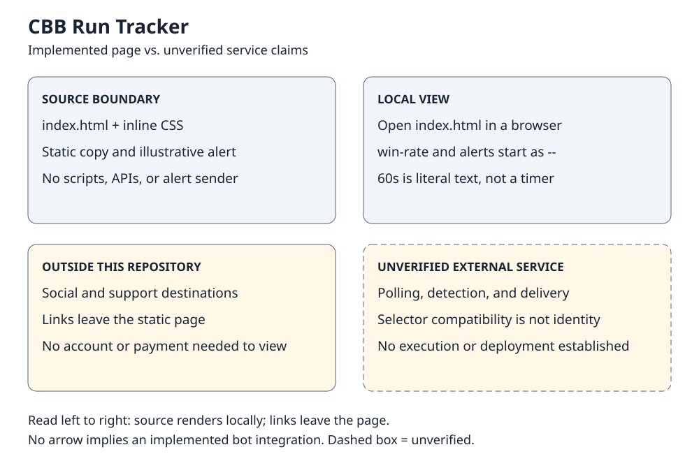

# CBB Run Tracker — static landing page

This repository contains a promotional HTML/CSS page for a college-basketball run-alert concept. It is **not the tracking bot**: there is no polling, run detection, API client, alert sender, betting engine, or live statistics client in this repository.

## View locally — no build required

Open [`index.html`](index.html) directly in a web browser. All page styling is inline; there are no package dependencies, installation steps, compilation steps, or environment variables required to view it. A static file host can also serve it without a build command. This describes viewing the page, not configuring or operating an alert service.

Viewing does not require clicking the external social or support links. Those links leave this repository; no payment or account connection is necessary. Their destinations and any associated live service have not been validated by this documentation change.

## What is actually implemented

- Responsive static HTML with inline CSS, descriptive workflow copy, a hard-coded example alert, social/support links, and the existing footer credit.
- Two placeholder statistics: `div.stat-number#win-rate` and `div.stat-number#alerts`, both initially `--`.
- A literal `60s` tweet-delay label. There is no timer or JavaScript updater.

The example score, clock, probability, and suggested strategy are **illustrative copy**, not an independently verified event, recommendation, backtest, or result. The page's polling interval, alert thresholds, timing, API context, beta/free status, and performance/market claims describe a proposed or external service; they are not demonstrated by this source. No claim of predictive accuracy, profit, statistical edge, current operation, or successful delivery follows from the page. The responsible-gambling footer remains intact, but does not validate those claims.

## Boundary map

- [Accessible standalone preview and text equivalent](docs/boundary.html)
- [Editable Excalidraw scene](docs/boundary.excalidraw) — import it into Excalidraw to edit the boxes and text.
- [Editable SVG preview](docs/boundary.svg) — text and shapes remain vector elements.

The map documents a source boundary, not an operating deployment. The Excalidraw scene and SVG are separately editable representations of the same content; neither auto-generates the other. Keep both and the preview/text equivalent aligned when editing. Native Excalidraw import/round-trip has not been verified.

### Possible bot relationship — not established here

A separate audit reported that `cbb-run-tracker-bot`, at commit `4336250d251c61f58101153be3b3da3e0def203e`, has an updater for an unnamed `landing-page/index.html` using the same `stat-number` class and `win-rate` / `alerts` IDs. See the [reported updater source](https://github.com/JDKristenson/cbb-run-tracker-bot/blob/4336250d251c61f58101153be3b3da3e0def203e/run_tracker.py#L422-L505).

This repository's selectors are compatible with that reported contract. **Matching selectors do not prove that the external folder's remote is this repository**, that any updater ran, or that a deployed site receives updates. The bot source was not independently inspected for this documentation change. No bot code, configuration, or credentials are included or needed here.

## Provenance, attribution, and license status

Source baseline: default branch `master`, commit [`8ae8ed74f6704691ef908b7617afe357f0868ff0`](https://github.com/JDKristenson/cbb-run-tracker/tree/8ae8ed74f6704691ef908b7617afe357f0868ff0). At that baseline the complete tracked tree was `index.html` only, with no repository instructions, README, manifest, license, or notices file.

The available two-commit history records an [initial landing page](https://github.com/JDKristenson/cbb-run-tracker/commit/90e14d5d588aa34ab8fb11d18edac0ea6f62214f) on December 30, 2025 at 20:59:20 −05:00, followed by a [support-button addition](https://github.com/JDKristenson/cbb-run-tracker/commit/8ae8ed74f6704691ef908b7617afe357f0868ff0) at 21:55:43 −05:00. These are recorded Git timestamps, not proof of first creation or deployment.

The page says **“Built by @JDKristenson”**. That existing credit is preserved unchanged. Namespace, footer, and commit metadata alone do not establish exclusive authorship or rule out upstream templates, collaborators, or AI assistance. Original-source provenance remains **unresolved**; no additional historical credits were found in the baseline source. Preserve all existing credits and add any verified upstream/collaborator/AI acknowledgments rather than replacing them.

This README and the new boundary drawings were prepared with AI assistance from Reason. The drawings are newly composed documentation, not recovered historical architecture or an upstream asset.

**No license grant was present at the baseline, and this change does not add one.** Public visibility is not a license. Before reuse or redistribution, establish the relevant rights and provenance and obtain appropriate permission; do not assume a license or remove attribution. This is a status note, not legal advice.

## Maintenance and verification boundaries

For portfolio presentation, describe this as a static promotional frontend and distinguish any independently evidenced bot contribution. Avoid claiming live analytics or validated betting performance from this repository alone.

For documentation-only changes, check that `index.html` and its footer credit are unchanged, local documentation links resolve, and diagram text remains consistent across SVG, HTML, and Excalidraw. There is no existing package-based build or test suite. Review public source/history for unintended identity/contact exposure before broader reuse; keep any future secrets server-side and verify external data-provider permissions separately.

This documentation does not attest to a running deployment. Bot execution, betting validation, external sends, payments, API access, credential checks, service operation, and deployment were not performed. No runtime or hosting configuration is introduced.
